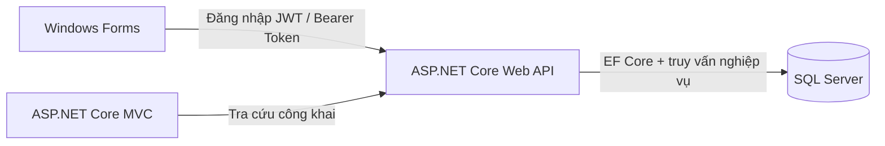

# Kiến trúc tổng thể

Desktop và Web không truy cập SQL Server trực tiếp; API là lớp truy cập nghiệp vụ dùng chung. API xác thực nhân viên bằng JWT và áp dụng role Admin/Librarian cho CRUD đầu sách, mượn và trả. Tra cứu danh mục sách công khai vẫn không yêu cầu token. Bảng `Accounts` lưu password hash PBKDF2-SHA256, không lưu mật khẩu thuần.

Schema tách đầu sách và bản sao; bảng trung gian biểu diễn quan hệ nhiều-nhiều giữa sách và tác giả; giao dịch mượn/trả giữ lịch sử.

## Ma trận quyền hiện được triển khai một phần

| Chức năng | Quản trị viên | Thủ thư | Bạn đọc |
|---|---:|---:|---:|
| Đăng nhập ứng dụng Desktop | Có | Có | Không |
| CRUD đầu sách qua API/Desktop | Có | Có | Không |
| Mượn, trả qua API | Có | Có | Không |
| Tra cứu sách công khai | Có | Có | Có |
| Quản lý tác giả/thể loại/bản sao | Chưa có màn hình | Chưa có màn hình | Không |
| Hồ sơ/lịch sử cá nhân | Chưa triển khai | Chưa triển khai | Chưa triển khai |

## Ranh giới hiện tại

Phần bổ sung mới hoàn thiện mã nguồn đăng nhập nhân viên, phân quyền một số API và CRUD đầu sách. Quản lý bản sao, bạn đọc, đặt trước, thanh toán phạt, hồ sơ/lịch sử, báo cáo, nhật ký và backup/restore còn phải triển khai. Mã nguồn bổ sung cần được restore/build và kiểm thử trên máy phát triển trước khi xem là chức năng đã xác minh.
