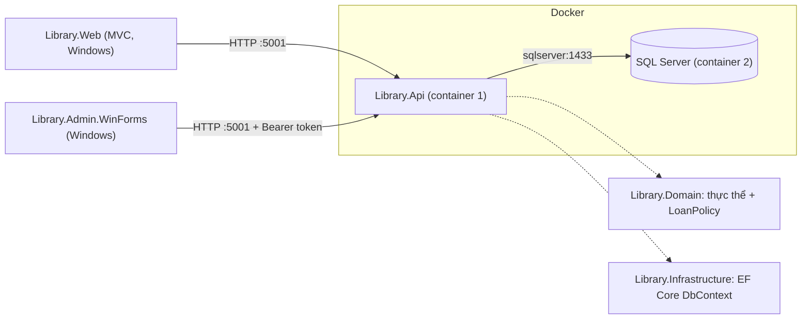

# Kiến trúc tổng thể

## Trách nhiệm từng project
| Project | Trách nhiệm |
|---|---|
| Library.Domain | Thực thể, quy tắc nghiệp vụ thuần (`LoanPolicy`). Không phụ thuộc hạ tầng. |
| Library.Infrastructure | `LibraryDbContext` (EF Core, SQL Server). |
| Library.Api | Xác thực/phân quyền, validation, nghiệp vụ mượn-trả (transaction), CRUD quản trị, API công khai tra cứu. Duy nhất truy cập SQL Server. |
| Library.Web | Giao diện bạn đọc, chỉ gọi API. |
| Library.Admin.WinForms | Giao diện thủ thư/quản trị, chỉ gọi API. |

Luồng: `Web/WinForms → HTTP → Library.Api → (EF Core hoặc ADO.NET) → SQL Server`. Truy vấn tra cứu công khai dùng EF Core; các thao tác ghi cần transaction nghiêm ngặt (mượn/trả, CRUD allowlist) dùng ADO.NET tham số hóa.

## Ma trận quyền
| Chức năng | Admin | Librarian | Bạn đọc |
|---|---|---|---|
| Quản lý tài khoản thủ thư, vai trò | Có | Không | Không |
| CRUD sách, bản sao, bạn đọc, danh mục | Có | Có | Không |
| Mượn, trả | Có | Có | Không |
| Tra cứu sách công khai (Web) | Có | Có | Có |
| Đặt trước, xem lịch sử mượn | Quản lý trạng thái | Xử lý/giữ sách | Có trên Web |
| Thu tiền phạt | Có | Có | Xem số đã thanh toán trong lịch sử |
