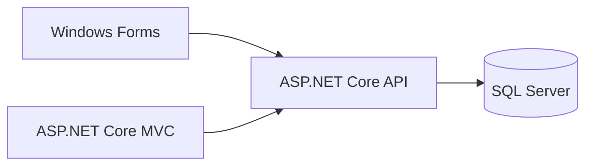

# Kiến trúc tổng thể

Desktop và Web cùng dùng API làm lớp truy cập nghiệp vụ; API kết nối một cơ sở dữ liệu SQL Server. Schema tách đầu sách và bản sao; bảng trung gian biểu diễn tác giả; giao dịch mượn/trả giữ lịch sử.

## Ma trận quyền dự kiến
| Chức năng | Quản trị viên | Thủ thư | Bạn đọc |
|---|---:|---:|---:|
| Quản lý tài khoản, vai trò | Có | Không | Không |
| Quản lý danh mục, bản sao | Có | Có | Không |
| Mượn, trả, báo cáo | Có | Có | Không |
| Tra cứu sách công khai | Có | Có | Có |
| Hồ sơ/lịch sử cá nhân | Có theo hỗ trợ | Theo nhiệm vụ | Chỉ của mình |

## Ranh giới
Các màn hình CRUD và quy trình trả, đặt trước, tài khoản, backup/restore còn phải triển khai trước khi có thể tuyên bố hoàn thành toàn bộ FR/UC/US/NFR.
