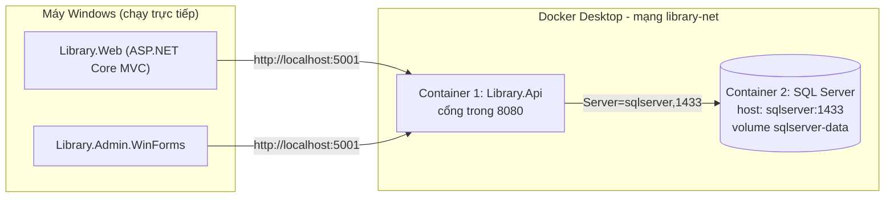

# Triển khai Docker hai container

## Mô hình



- **Container `sqlserver`**: SQL Server 2022, dữ liệu lưu ở volume `sqlserver-data`.
- **Container `api`**: Library.Api, được build từ `Dockerfile` ở thư mục gốc.
- Web MVC và WinForms **không** nằm trong Docker; cả hai gọi cùng một API nên dùng chung dữ liệu.
- `docker-compose.yml` chỉ là công cụ điều phối hai container, không phải container thứ ba.

## Vai trò từng file
| File | Vai trò |
|---|---|
| `Dockerfile` | Build Library.Api nhiều giai đoạn (SDK để build, runtime ASP.NET để chạy); đưa Domain, Infrastructure vào context; copy `Database/` để khởi tạo CSDL. |
| `docker-compose.yml` | Khai báo 2 service, mạng `library-net`, volume, cổng, biến môi trường, healthcheck và thứ tự khởi động (`depends_on: service_healthy`). |
| `.env` (tạo từ `.env.example`) | Mật khẩu SA, mật khẩu admin, cổng. Không commit. |
| `.dockerignore` | Loại `bin/`, `obj/`, `.git`, Web, WinForms... khỏi build context. |

## Kết nối API ↔ SQL Server
- Connection string trong container: `Server=sqlserver,1433;...` (tên service, **không** dùng `localhost`).
- API chờ SQL Server sẵn sàng (thử lại tối đa 30 lần, mỗi 2 giây) trước khi khởi tạo; ngoài ra compose có healthcheck cho SQL Server.
- Lần chạy đầu, API tự chạy `Database/01..04` (chỉ khi database chưa có bảng `Settings`), sau đó áp dụng migration idempotent `Database/07_ProfessionalSkills_Update.sql` cho cả database mới lẫn volume đã tồn tại. API tạo tài khoản `admin` với mật khẩu lấy từ `ADMIN_PASSWORD`. Script `05` (truy vấn thử) và `06` (admin demo cho máy local) không chạy trong Docker.

## Chạy hệ thống
```powershell
copy .env.example .env          # rồi sửa MSSQL_SA_PASSWORD, ADMIN_PASSWORD
docker compose up -d --build
docker compose ps               # sqlserver: healthy, api: running
docker compose logs api         # xem log khởi tạo database
curl http://localhost:5001/health
curl http://localhost:5001/health/db   # {"status":"ok","database":"connected","books":N}
```
Sau đó trên Windows: chạy `Library.Web` (Visual Studio hoặc `dotnet run --project Source/Library.Web`) và `Library.Admin.WinForms`, đăng nhập `admin` với mật khẩu trong `.env`.

Nếu đổi cổng API trên host: đặt `LibraryApi__BaseUrl` cho Web và `LIBRARY_API_URL` cho WinForms (ví dụ `http://localhost:5050/`).

## Dừng / chạy lại / xóa
```powershell
docker compose stop        # dừng, giữ dữ liệu
docker compose up -d       # chạy lại, dữ liệu còn nguyên (volume)
docker compose down        # xóa container, VẪN giữ volume
docker compose down -v     # xóa cả dữ liệu (khởi tạo lại từ đầu)
```
Nếu lần khởi tạo đầu bị gián đoạn giữa chừng, chạy `docker compose down -v` rồi `up` lại.

## Giới hạn
- Chưa được build/chạy thử trong môi trường soạn tài liệu (không có Docker). Cần chạy theo `KiemThu.md` mục Docker và chụp ảnh minh chứng.
- Image `mssql/server` không có bản chạy native cho CPU ARM (Mac M-series) ngoài giả lập; Windows x64 không gặp vấn đề này.
- Phiên đăng nhập lưu trong bộ nhớ API: khởi động lại container `api` thì phải đăng nhập lại.
